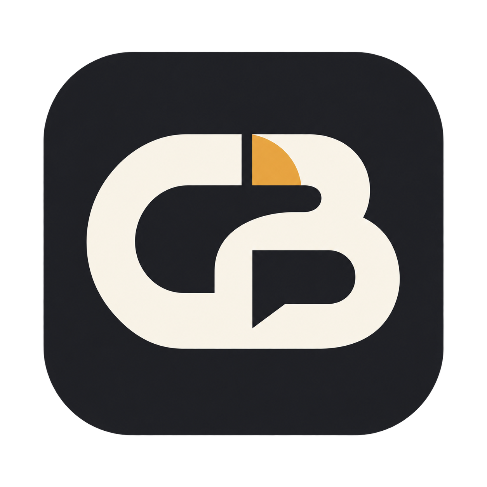
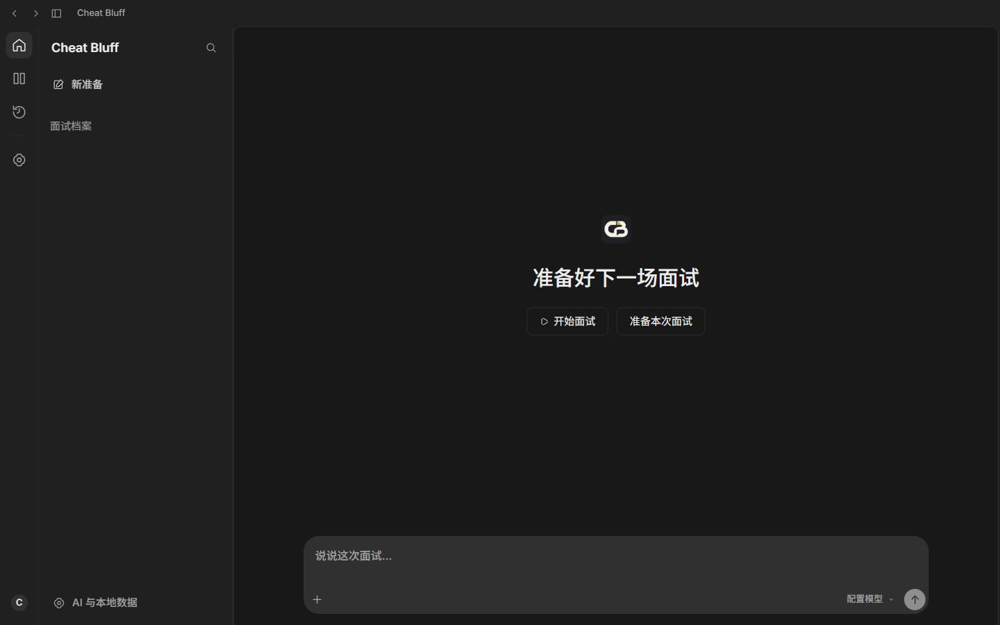
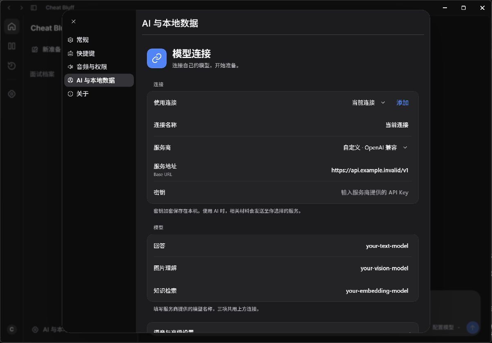

<div align="center">
  
  <h1>Cheat Bluff</h1>
  <p><strong>Explain your work clearly. Prepare for your next interview.</strong></p>
  <p>A focused Windows workspace for interview preparation and personal knowledge.</p>
  <p><a href="README.md">简体中文</a> · <strong>English</strong></p>
  <p><a href="https://github.com/Chenxxxxxx06/cheat-bluff/releases/latest"><strong>↓ Download for Windows</strong></a>　·　<a href="#get-started-in-three-steps">Quick start</a>　·　<a href="https://github.com/Chenxxxxxx06/cheat-bluff/issues">Feedback</a></p>
</div>

<br />



<p align="center"><sub>A clean workspace. Your own materials.</sub></p>

## From building it to explaining it

You have worked on plenty of projects, but where do you start when someone asks about them? Bring your resume, papers, code and notes together, prepare for a specific role, then review what you can improve.

| Organize | Prepare | Review |
| :--- | :--- | :--- |
| Build your personal knowledge base | Practice around the company, role and job description | Browse records on a timeline |
| Keep source evidence with knowledge cards | Work on project introductions and follow-up questions | Search with keywords or `Ctrl+F` |
| Separate contributions from reference material | Start with short, practical guidance | Rename, delete, restore and add notes |

Light and dark themes follow your system, and panes are resizable. Materials and records stay on your computer. When you use a cloud model, relevant inputs are sent to the service you configure.

## Get started in three steps

**① Download and install**

Go to **[Releases](https://github.com/Chenxxxxxx06/cheat-bluff/releases/latest)**, download `Cheat-Bluff-Setup-0.6.0-x64.exe`, and run it. Supports Windows 10 / 11 x64. The installer includes the application runtime and local OCR; no Node.js, Python setup or compilation is needed.

The installer is not currently signed with a trusted code-signing certificate, so Windows may show “Unknown publisher.” Download only from this repository's Releases and check the included SHA-256 file if needed.

**② Add your own materials**

Open the personal knowledge library, create a profile, and import your resume, project notes, papers or code. Review the knowledge cards before practicing with them.

**③ Prepare your next interview**

Configure your own model connection in “AI 与本地数据”, create a preparation, add the role requirements, and start practicing. Return to the records afterward to add your review notes.

> **Starts empty. Configured by you.** No author credentials, accounts, knowledge base, interview history or shared model quota are included. Browsing and material management work without a model connection; AI answers require your own service. Live speech uses the DashScope WebSocket protocol.

<details>
<summary>Prefer running from source?</summary>

Requires Windows, Node.js 24 and npm:

```bash
git clone https://github.com/Chenxxxxxx06/cheat-bluff.git
cd cheat-bluff
npm ci
npm start
```

```bash
npm test
npm run verify:public
npm run package:dir
```

The source repository does not include the large OCR runtime and models. Download the Release installer for bundled OCR. Application data is stored separately in `%APPDATA%/CheatBluff/`; it does not read the author's old data directory or other AI applications' login credentials.

</details>

## Latest source updates

Apple-inspired grouped connection settings, more conversational project answers, and fixes for multi-part questions and unrelated project context.



### Import and update your materials

- Import PDF/DOCX resumes, text PDFs, common source files, or a local folder. Code is read as text; it is not executed. Legacy DOC files need conversion to DOCX or PDF.
- Importing saves extracted text locally. Click **AI distill** after configuring your own model, then review any personal-contribution cards before using them.
- Reimport the same files after editing them. Unchanged content is reused; changed sources invalidate old cards and are distilled again. There is no automatic filesystem watching.
- Scanned PDFs and images need the local OCR runtime. Release 0.6.0 includes it; a source checkout requires separate preparation. Poor scans may still need manual correction. Single-file imports are limited to 30 MB, and long materials may be truncated or require splitting.

These changes are on the source branch; the existing 0.6.0 installer has not been replaced by this commit.

## Get your resume ready, too

There is a companion **[Chinese LaTeX resume template →](https://github.com/Chenxxxxxx06/chinese-resume-latex)** with Chinese typography, project entries, clickable links and logo slots. Fill in your own content, compile with XeLaTeX or Overleaf, then import the resulting PDF into Cheat Bluff.

A small suggestion inspired by Asu: **sketch a simple project logo and put it in your resume.** It only needs to be clear and recognizable at a small size. Place the image in the template's `assets/` directory:

```latex
\projectentry[assets/project-logo.png]
  {Your project}{Your role}{Tech stack or a one-line description}
```

A short guide to logo sizing, vector exports and LaTeX layout is planned.

## What's next

- [ ] Make answers more conversational, with fewer stock phrases.
- [ ] Keep fixing bugs and improve error messages and small usability details.
- [ ] Refine resolutions, display scaling and narrow-window layouts.
- [ ] Improve knowledge deduplication, project ownership checks and citations.
- [ ] Make model setup easier and support more compatible services.
- [ ] Add a project-logo-to-LaTeX-resume tutorial.
- [ ] Document recovered code and improve provenance and licensing records.

## Why build this?

Tibo kept resetting lately, so I took the opportunity to finally build the interview tool I had been thinking about. Hopefully it makes your preparation a little easier, too.

**Issues are welcome!** Send questions, bug reports, ideas or suggestions. I will read them carefully and do my best to fix reproducible problems. Let's make the app more useful together.

[Report a problem / share an idea →](https://github.com/Chenxxxxxx06/cheat-bluff/issues/new/choose)

<sub>Please include steps to reproduce and redact personal information and credentials from screenshots and logs.</sub>

---

<p align="center">Made by <strong>undestand</strong> · <a href="docs/SOURCE_PROVENANCE.md">Source and licensing notes</a></p>
